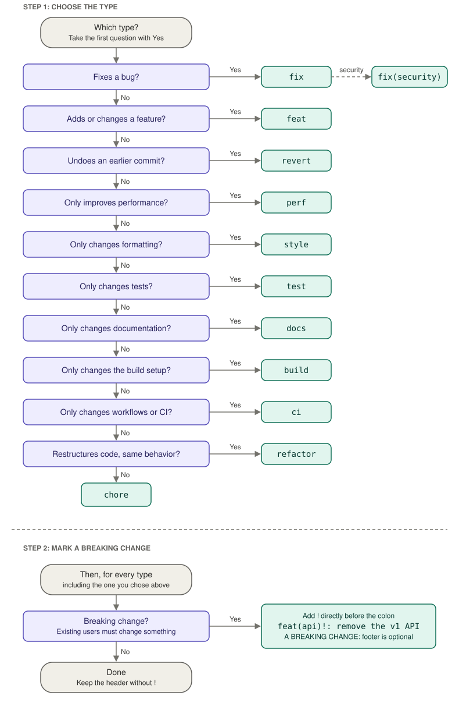

# Conventional Commits Cheatsheet

A quick reference for commit messages and pull request titles in this
repository. It follows
[Conventional Commits 1.0.0](https://conventionalcommits.org) and the rules in
[CONTRIBUTING.md](../../CONTRIBUTING.md#commit-messages). When this cheatsheet
and `CONTRIBUTING.md` differ, `CONTRIBUTING.md` wins.

## Format

```none
<type>(<optional scope>)<optional !>: <subject>

<optional body>

<optional footer>
```

- Write everything in **English**.
- Leave one blank line between the header, the body, and the footer.
- Sign your commits when you can, so they show as `Verified` on GitHub.

## Types

Only these 11 types are accepted. The pull request check rejects a title with
any other type.

| Type       | Use it for                                                     | Changelog |
| ---------- | -------------------------------------------------------------- | --------- |
| `feat`     | A new feature or a new behavior for the user.                  | Added     |
| `fix`      | A bugfix. `fix(security)` is a security fix.                   | Fixed     |
| `perf`     | A change that only makes the code faster or lighter.           | Changed   |
| `refactor` | A restructure without a new feature or a bugfix.               | Changed   |
| `style`    | Formatting, whitespace, or quotes; no change in logic.         | Changed   |
| `test`     | New tests or changes to existing tests.                        | Changed   |
| `docs`     | Documentation only.                                            | Changed   |
| `build`    | Build tooling, `package.json` scripts, or the build setup.     | Changed   |
| `ci`       | Workflows, linters, and other CI configuration.                | Changed   |
| `revert`   | Undoing an earlier commit.                                     | Changed   |
| `chore`    | Maintenance, such as `.gitignore` edits or dependency updates. | Changed   |

`fix(security)` goes to the **Security** category of the changelog.

`hotfix` is a branch prefix, not a type. An urgent fix on a `hotfix/` branch has
the type `fix`.

## Choose the Type

Go down the list and take the first answer that is "yes". This keeps the choice
consistent and stops `chore` from becoming a catch-all.

1. Does it fix a bug? → `fix`
2. Does it add or change a feature for the user? → `feat`
3. Does it undo an earlier commit? → `revert`
4. Does it only improve performance? → `perf`
5. Does it only change the formatting? → `style`
6. Does it only change tests? → `test`
7. Does it only change documentation? → `docs`
8. Does it only change the build setup? → `build`
9. Does it only change workflows or CI configuration? → `ci`
10. Does it restructure code without a change in behavior? → `refactor`
11. Anything else, such as a dependency update → `chore`

Then, for every type: is it a breaking change? Add `!` directly before the
colon, such as `feat(api)!:`. See [Breaking Changes](#breaking-changes).

<details>
<summary>Show the decision flowchart (click to expand)</summary>



</details>

## Scope

- Optional. It names the part of the codebase that changed, such as `core`,
  `data`, or `cli`.
- Lowercase letters, digits, `_`, and `-` only: `(ci_cd)`, `(pre-commit)`.
- Use a noun, not an issue number. Put the issue number in the footer.
- Common scopes in this repository:

| Scope       | Part of the repository                    |
| ----------- | ----------------------------------------- |
| `deps`      | Dependency updates: `chore(deps)`         |
| `changelog` | `CHANGELOG.md`                            |
| `workflows` | Files in `.github/workflows/`             |
| `renovate`  | `.github/renovate.json`                   |
| `release`   | The Release Manager workflow              |
| `labels`    | `.github/labels.yml` and the label policy |
| `readme`    | `README.md`                               |
| `security`  | Security fixes (category Security)        |

## Subject

- **Imperative mood**, present tense: `add`, not `added` or `adds`.
- Start with a letter. Lowercase is preferred.
- Keep the subject **under 50 characters**.
- Do not end with a period.
- Write from the user's perspective: the subject of a pull request title becomes
  the changelog entry.

| Good                                 | Bad                                     |
| ------------------------------------ | --------------------------------------- |
| `feat(cli): add JSON export command` | `feat(cli): Added JSON export command.` |
| `fix(parser): handle empty input`    | `fix: bug #123`                         |
| `docs: update installation steps`    | `update docs`                           |
| `ci(workflows): pin actions to SHA`  | `chore: stuff`                          |

## Body

- Optional. Explain **what** changed and **why**, not how.
- Contrast the new behavior with the old one when that helps.
- Use bullet points (`-`) for several items.
- Keep lines **under 72 characters**.

## Footer

- Reference issues: `Closes #42`, `Refs #17`.
- Describe a breaking change with `BREAKING CHANGE: <description>`. The token is
  uppercase. `BREAKING-CHANGE` means the same.
- A footer is a token, then `: ` or ` #`, then a value. Use `-` instead of
  spaces in the token, such as `Reviewed-by`. `BREAKING CHANGE` is the
  exception.
- Do not add AI attribution lines such as "Generated with". Say in the pull
  request which AI tools you used, as `CONTRIBUTING.md` asks.

## Breaking Changes

A breaking change can have any type. Mark it in one of two ways, or both:

- With `!` directly before the colon: `feat(api)!:`. The `BREAKING CHANGE:`
  footer is then optional.
- With a `BREAKING CHANGE: <description>` footer.

Always use `!` in the pull request title. The changelog and the release notes
are made from the title, so a footer alone is not visible there.

```git
feat(api)!: remove the v1 endpoints

BREAKING CHANGE: the /v1 routes are gone. Use the /v2 routes instead.
```

## Versioning

Releases are made by hand with the Release Manager workflow. The commits do not
choose the version, but they tell you which bump to pick. The highest row wins:

| The release contains                    | Bump    | Example             |
| --------------------------------------- | ------- | ------------------- |
| A breaking change (`!` or the footer)   | `major` | `v1.4.2` → `v2.0.0` |
| A `feat`                                | `minor` | `v1.4.2` → `v1.5.0` |
| A `fix`                                 | `patch` | `v1.4.2` → `v1.4.3` |
| Only other types (`docs`, `chore`, ...) | none    | No release needed   |

Other types have no effect on the version, unless they are a breaking change.

## Pull Request Titles

- The title must be a conventional commit. The pull request check enforces it.
- The Update Changelog workflow turns the title into the changelog entry, so the
  title matters more than the individual commits. Pull requests of a bot get no
  entry.
- Pull requests of a bot are left out of the release notes, unless their type is
  `feat`, `fix`, `perf`, `refactor`, or `revert`.

## Examples

```git
feat(cli): add JSON export command
```

```git
fix(parser): handle null reference on empty input

- Added a null check before iterating over the entries.
- Updated unit tests to cover the empty-input edge case.

Closes #42
```

```git
fix(security): escape user input in the search query
```

```git
perf(cache): reuse the parsed config between runs
```

```git
refactor(init): split the prompts into functions
```

```git
docs: update installation steps in README
```

```git
chore(deps): update prettier to v3.6.2
```

```git
ci(workflows): run the linter on pull requests
```

```git
revert: feat(cli): add JSON export command

The export breaks on Windows.

Refs: 1a2b3c4
```

```git
chore: ignore the local .env file
```

## Quick Validation

The pull request check uses this pattern for the title:

```none
^(feat|fix|docs|style|refactor|perf|test|chore|revert|build|ci)(\([a-z0-9_\-]+\))?(\!)?:[[:space:]][A-Za-z].*
```

## References

- [Conventional Commits 1.0.0](https://www.conventionalcommits.org/en/v1.0.0/)
- [Semantic Versioning 2.0.0](https://semver.org)
- [CONTRIBUTING.md](../../CONTRIBUTING.md#commit-messages)
